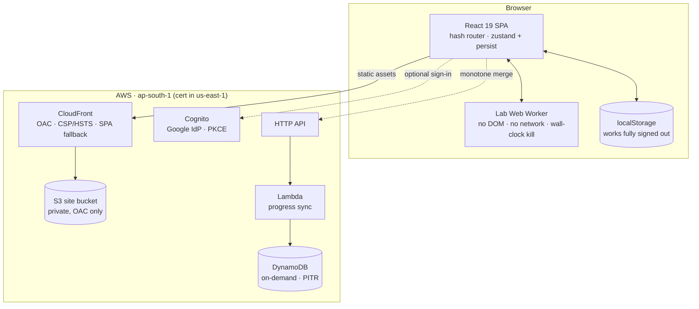

# duo1c Learn

**A DSA curriculum that checks your complexity, not just your answer.**

[**learn.duo1c.in**](https://learn.duo1c.in) · 58 topics · 6 tiers · 24 weeks

Every other DSA site checks whether your code returns the right value. This one runs your
solution at n, 2n, 4n and 8n, fits the growth curve, and rejects it if the curve is the wrong
shape — so a correct-but-quadratic answer fails, out loud, with the measurement attached.

```
Complexity gate · target O(n)
Time grew 3.94× per doubling of n — above the 3.20× limit.
That curve is a slower class than O(n). Correct, but not within budget.

n=4,000 → 1.14ms   n=8,000 → 4.42ms   n=16,000 → 17.6ms   n=32,000 → 69.3ms
```

Stating the complexity budget out loud and then *verifying you hit it* is the habit the whole
curriculum is built around. Making it a gate rather than an honour system is the one genuinely
novel thing here.

---

## Contents

| | |
| --- | --- |
| **58** topics across **6** tiers | Foundations → Judgment |
| **465** quiz questions | tagged `recall` / `apply` / `judge`, every wrong option explained |
| **52** code labs | **42** with an enforced complexity gate |
| **15** decision cases | the judgment tier, graded on reasoning |
| **30** algorithm visualisers | real implementations, instrumented and replayed frame by frame |
| **~58,000** words | in the long-form explainers alone |

| Tier | Name | Topics | The pitch |
| --- | --- | --- | --- |
| 0 | Foundations | 9 | Non-negotiable. If you hesitate here, everything above it is shaky. |
| 1 | Core structures | 12 | The structures you reach for without thinking, once they are reflexive. |
| 2 | Graphs | 9 | Once you see the graph, the algorithm is usually already known. |
| 3 | Dynamic programming | 10 | Where most working engineers actually have a gap. |
| 4 | Advanced structures | 13 | Where "advanced DSA" actually lives. |
| 5 | Judgment | 5 | Not problems — the thing that makes you senior. |

**The whole site is public — nothing is behind the login.** Signed out, all 58 topics and
every mode work, stored in `localStorage`. Signing in with Google adds exactly one thing:
durability and cross-device sync.

---

## How a topic works

Three modes, three independent gates. A topic is **mastered** only when all three clear.

### Learn

A long-form explainer — intuition before formalism, five mechanics, a derivation of *why* the
bound is what it is, four named variants, three head-to-head trade-offs — plus four real-world
cases showing where the structure actually earns its keep. Every jargon term links to a
plain-English definition on first use.

Prose is written for readers in India: plain English, no idioms that do not travel, and
examples drawn from IRCTC, UPI, Aadhaar and Indian-language text handling alongside the usual
industry ones.

### Solve

Write the code. Pass the tests. **Then clear the complexity gate.**

```ts
complexityGate: {
  target: "O(n)",
  // Worst case on purpose: no pair exists, so the pointers must traverse
  // the whole array. A nested-loop solution goes quadratic here even
  // though it passes every correctness test above.
  gen: "(n) => [Array.from({ length: n }, (_, i) => i * 2), 2 * n + 1]",
  sizes: [4000, 8000, 16000, 32000],
}
```

Submissions run in a Web Worker with no DOM, no network and a hard wall-clock kill — a
genuinely safe sandbox, with no backend, no bill and no abuse surface.

Tier 5 has nothing to animate and nothing to code, so it gets **decision cases** instead: a
scenario, three or four defensible approaches of which one is best *under the stated
constraints*, and a rubric asking you to name the trade you are accepting, the failure mode
you are signing up for, and what you would measure. Graded exact-set — ticking everything
fails, which is the point.

### Quiz

Multiple choice where **every wrong option carries its own rationale** explaining why it was
tempting. Naming the attraction is where a misconception actually gets corrected; "not quite"
teaches nothing.

---

## The thresholds are calibrated, not theoretical

This is the part that took longest to get right, and it is worth reading before touching the
gate.

Theory says a linear solution doubles (2.00×) and a quadratic one quadruples (4.00×), so the
midpoint `sqrt(2·4) = 2.83` looks like the obvious cut. **Measurement disagrees.** Real linear
JavaScript measures 2.0–2.8× per doubling once you count allocation, hash-map growth and cache
misses. A 2.83 cut therefore rejects correct solutions.

| Target | Correct measures | Wrong measures | Threshold |
| --- | --- | --- | --- |
| `O(log n)` | 1.1 – 1.2 | ~2.0 | **1.50** |
| `O(n)` | 2.0 – 2.8 | 3.6 – 4.3 | **3.20** |
| `O(n log n)` | 2.2 – 2.5 | 3.6 – 4.0 | **3.15** |
| `O(n·m)` / `O(n^2)` | 3.6 – 4.6 | 7.5 – 8.5 | **5.66** |
| `O(n^3)` | 7.2 – 9.0 | 15 – 17 | **11.30** |

Each threshold is the geometric midpoint of the two *measured* ranges. Two further details,
each learned from a real bug:

- **Warm up at every size.** V8 only optimises a function after several calls, so warming up
  once leaves the first size running in unoptimised code — which flattens the measured curve
  and let a genuinely quadratic solution measure 2.13× and pass.
- **Fit by least squares across all sizes**, not a median of adjacent ratios. One unlucky
  measurement should not decide a verdict.

`scripts/labs.mts` re-measures every reference solution on demand and **fails any gate with
under 15% headroom** — because a gate that barely clears its own reference will reject a
reader's correct-but-slightly-slower solution.

### What that audit has caught

It is not decorative. Three findings that survived human review and did not survive
measurement:

- **Two wrong expected values** that had been reasoned through by eye — including the exact
  BST mistake the topic's own quiz warns about.
- **An LRU cache** written the elegant way, with `Map` delete-then-set eviction, measured
  **3.58× against a 3.20× limit**. V8 tombstones deleted entries and `keys().next()` has to
  walk past them. The map-plus-linked-list version measures ~2.5× and is about 12× faster at
  32,000 operations.
- **A gate that had to be deleted.** For `skip-lists`, a sorted array with `splice` measured
  3.12–3.17× against the skip list's 2.63–2.67×, and at smaller sizes dropped to 2.7× and
  passed outright. There is no size range where the gate both clears the correct answer and
  rejects the wrong one, because V8's `splice` is a `memmove`. A gate that cannot discriminate
  is worse than none, so that lab ships gate-free — and the measurement became curriculum
  content instead.

---

## Running it

```bash
npm install
npm run dev
```

No backend, no environment variables, no AWS account. Auth and sync stay dormant until the
`VITE_*` values exist, and every topic works without them.

```bash
npm run build     # tsc -b && vite build
npm run lint      # oxlint
```

### The audits

```bash
node --experimental-strip-types scripts/coverage.mts   # topic / quiz / visualiser counts
node --experimental-strip-types scripts/labs.mts       # every lab vs its own tests AND gate
```

`coverage.mts` is the source of truth for the tables in the docs — they are generated, never
hand-maintained. **`labs.mts` is not optional after touching a lab.**

---

## Architecture



Infrastructure is CDK in `infra/` — four stacks (`Data`, `Auth`, `Api`, `Site`). `deploy.sh`
runs two passes because Vite bakes `VITE_*` at build time while the Cognito and API values
only exist after those stacks deploy.

Sync **merges monotonically** — `max` / `OR` / `union` on every field — which makes it
commutative and idempotent, so concurrent devices need no coordination and a retried request
cannot double-count.

---

## Layout

```
src/
  data/
    topics/<id>.ts     one file per topic — 58 of them
    tiers/tierN.ts     composes topics into tiers
    glossary.ts        plain-English definitions, linked on first mention
    types.ts           Topic · CodeLab · DecisionCase · ComplexityTarget
  engine/
    lab/runner.ts      the complexity gate — thresholds and the least-squares fit
    lab/lab.worker.ts  the sandbox
    algorithms/        instrumented real implementations → replayable traces
  views/modes/         Learn · Solve (Lab | Cases) · Quiz
infra/                 CDK: Data, Auth, Api, Site
scripts/               deploy.sh · coverage.mts · labs.mts
docs/                  architecture · content · runbook
```

One file per topic is deliberate: a single file holding every topic at full depth would run
past twenty thousand lines, which no editor and no reviewer handles well.

---

## Design constraints

`CLAUDE.md` carries the full list. Each was learned from a real bug, so breaking one
reintroduces it. A representative few:

- **Container entrances animate position, never opacity.** A fade-in that never completes —
  suspended renderer, bfcache restore, dropped frame — leaves an `opacity: 0` container
  invisible with no recovery.
- **No `<AnimatePresence mode="wait">` on anything route-, timer- or tap-driven.** Two changes
  in one frame leave the outgoing view stuck mid-exit and the incoming one never mounted.
- **Never add `unsafe-eval` to the page CSP.** The lab worker needs it and gets it from its own
  response-headers policy, because a dedicated same-origin worker carries its own CSP. A blob
  worker would inherit the page's.
- **Encoding colours are validated, not chosen.** Three state hues, checked all-pairs for
  colour-vision deficiency and contrast in both themes. A fourth fails the gate — "eliminated"
  is neutral plus a strike-through, never a new hue. The legend always names each state, so
  colour is never the only channel.

---

## Documentation

| Document | What it answers |
| --- | --- |
| [docs/architecture.md](docs/architecture.md) | Access model, auth flow, sync protocol, data model, resource inventory |
| [docs/content.md](docs/content.md) | What is covered, what is not, how to add a question / visualiser / topic |
| [docs/runbook.md](docs/runbook.md) | Deploy, roll back, troubleshoot, rotate secrets, delete data, costs, DNS |
| [docs/content-upgrade-plan.md](docs/content-upgrade-plan.md) | Why the content is shaped the way it is |

Account-specific identifiers in the docs are redacted as `<ACCOUNT_ID>`, `<CERT_ID>` and
similar. None is a credential; the runbook shows how to pull the live values from
CloudFormation for your own deployment.

---

## Stack

React 19 · TypeScript 6 · Vite 8 · Tailwind 4 · `motion` 12 · zustand 5 · oxlint
· AWS CDK (S3, CloudFront, Cognito, HTTP API, Lambda, DynamoDB)

## Licence

No licence has been chosen yet, so default copyright applies — all rights reserved.
